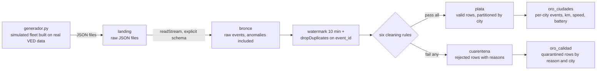

# IoT Streaming to Delta Lake

Vehicle telemetry is streamed with Spark Structured Streaming into cleaned, city-partitioned Delta Lake tables, on Databricks and locally.


[](LICENSE)

The notebooks, `informe.md`, `generador.py` and the screenshots are in Spanish; this README is the English entry point.

## Results

From the full run on Databricks serverless compute (Spark 4.2.0); the full validation report is [informe.md](informe.md).

- **No rows lost.** The generator wrote 13,204 events in 26 JSON files and bronze read all 13,204. They split into 11,931 silver rows, 1,069 quarantined rows and 204 duplicates removed. The row reconciliation difference is 0.
- **Cleaning matches the injected faults exactly.** For each of the six rules, the number of faulty records the generator injected equals the number the pipeline quarantined (191, 196, 126, 182, 131 and 243). Re-applying the rules to the written silver table finds 0 violations.
- **Partitioned by city.** Silver has one folder per city (Barcelona, Bilbao, Madrid, Sevilla, Valencia), holding between 2,319 and 2,520 rows each.
- **Delta features exercised.** `OPTIMIZE` compacted silver from 15 files to 5, and time travel read the table back at version 0 (4,132 rows), version 1 (8,250 rows) and version 3 (11,931 rows).

## Architecture

Bronze keeps the raw events, anomalies included. Silver and quarantine are produced from one stream with `foreachBatch`. Gold tables are batch aggregations.



The six cleaning rules, as implemented in the silver step. A row that breaks several rules gets all of their labels.

| Rule | Rejected when | Label |
|---|---|---|
| Speed | empty, negative or above 200 km/h | `VELOCIDAD_ABSURDA` |
| Coordinates | empty or outside the range of the Earth | `COORDENADA_IMPOSIBLE` |
| Coherence | the point is more than 0.5 degrees from the centre of its city | `FUERA_DE_CIUDAD` |
| Battery | empty, negative or above 100 | `BATERIA_FUERA_DE_RANGO` |
| Keys | vehicle, city or timestamp is missing | `CAMPO_VACIO` |
| City | the city is not one of the five known cities | `CIUDAD_DESCONOCIDA` |

## Screenshot


## Repository contents

| Path | What it is |
|---|---|
| [`Entregable-Databricks.ipynb`](Entregable-Databricks.ipynb) | The pipeline for Databricks, executed, with outputs embedded. Self-contained: the generator is embedded. Spanish. |
| [`Entregable.ipynb`](Entregable.ipynb) | The same pipeline running locally on PySpark, also executed. Spanish. |
| [`informe.md`](informe.md) | Validation report of the Databricks run. Spanish. |
| [`generador.py`](generador.py) | Simulates the fleet and writes the JSON files. Used by the local notebook only. |
| [`datos/semilla_ved.parquet`](datos/semilla_ved.parquet) | Seed data derived from the Vehicle Energy Dataset (12 MB). Used by both notebooks. |
| [`requirements.txt`](requirements.txt) | Dependencies for the local run. Databricks needs no installs. |
| [`Capturas/`](Capturas/) | Screenshots of the Databricks run. |
| [`docs/exercise-statement.md`](docs/exercise-statement.md) | The original exercise statement. |

Everything the pipeline generates (`lake/`, `rendimiento.png`) is recreated on each run and is gitignored.

## Run on Databricks

1. **Upload the seed.** In *Catalog*, create a volume named `telemetria` inside your schema and upload `datos/semilla_ved.parquet` to it.
2. **Import the notebook.** *Workspace*, then *Import*, then `Entregable-Databricks.ipynb`.
3. **Set the configuration.** In the first code cell, set `ALMACEN` to `"volumes"` (or `"dbfs"` if the workspace has no Unity Catalog) and set `CATALOGO`, `ESQUEMA` and `VOLUMEN` to your own.
4. **Attach compute and run all.** Any cluster on Databricks Runtime 13.3 LTS or later works, serverless included. Delta Lake, pandas and matplotlib ship with the runtime, so nothing needs installing.

## Run locally

Requirements: Python 3 and Java 8, 11 or 17 (needed by PySpark 3.5).

Windows (PowerShell):

```powershell
python -m venv .venv
.venv\Scripts\Activate.ps1
pip install -r requirements.txt
```

macOS and Linux (use `python3` if `python` is missing or points to Python 2):

```bash
python3 -m venv .venv
source .venv/bin/activate
pip install -r requirements.txt
```

**Windows only: Hadoop binaries.** Spark on Windows needs `winutils.exe` and `hadoop.dll`. They are not committed (`.hadoop/` is gitignored), so download them once from [`cdarlint/winutils`](https://github.com/cdarlint/winutils/tree/master/hadoop-3.3.6/bin) (`hadoop-3.3.6/bin`) into `.hadoop\bin`, from the repository root:

```powershell
New-Item -ItemType Directory -Force .hadoop\bin
Invoke-WebRequest https://raw.githubusercontent.com/cdarlint/winutils/master/hadoop-3.3.6/bin/winutils.exe -OutFile .hadoop\bin\winutils.exe
Invoke-WebRequest https://raw.githubusercontent.com/cdarlint/winutils/master/hadoop-3.3.6/bin/hadoop.dll -OutFile .hadoop\bin\hadoop.dll
```

The first code cell of `Entregable.ipynb` sets `HADOOP_HOME` to `.hadoop` in the project folder and puts `.hadoop\bin` on `PATH`. macOS and Linux need none of this.

Then start Jupyter from the repository root (the notebook resolves its paths from the working directory) and run `Entregable.ipynb` from top to bottom:

```bash
jupyter lab
```

The notebook launches the generator itself, so there is nothing else to start. A full run takes a few minutes.

## Troubleshooting

Databricks:

- **`FileNotFoundError: Falta .../semilla_ved.parquet`**: the seed is not in the volume, or `CATALOGO`, `ESQUEMA` and `VOLUMEN` do not match yours.
- **`Public DBFS root is disabled`**: the workspace does not allow writing to DBFS. Set `ALMACEN = "volumes"`.
- **`java.io.FileNotFoundException: /dbfs/...`**: the two ways of naming DBFS are mixed. Python uses `/dbfs/...` and Spark uses `dbfs:/...`. The `ruta()` helper converts between them, so always pass it the constants from the configuration cell instead of hand-written paths.

Local, any OS:

- **`DELTA_SCHEMA_NOT_SET`**: the silver cell ran before bronze wrote its first batch. Re-run the bronze cell and wait for it to print `bronce en marcha`.

Local, Windows:

- **`Could not locate executable winutils.exe`**: the Hadoop binaries are missing. Follow the Windows-only step in [Run locally](#run-locally).
- **Spark hangs on startup**: Spark picked up the `python` on `PATH`, which on Windows is often the Microsoft Store shortcut. The first cell fixes this by setting `PYSPARK_PYTHON`, so run it before anything else.
- **`Failed to delete ... temp dir` on shutdown**: normal Spark noise on Windows. It has no effect.

## Data

The seed comes from the [Vehicle Energy Dataset](https://github.com/gsoh/VED) (VED, University of Michigan, Apache-2.0): 27 real electric cars logged over OBD-II at 1 record per second in Ann Arbor, Michigan. It was prepared by keeping the vehicles that measure battery level and cleaning the records, which leaves 1,494,385 records from 1,590 trips. The generator then moves each trip to one of five Spanish cities, treats each trip as a separate vehicle and replays them 60 times faster than real time. Speed and battery level are never modified.

Citation: G. Oh, D. J. LeBlanc, H. Peng, "Vehicle Energy Dataset (VED), A Large-scale Dataset for Vehicle Energy Consumption Research", IEEE Transactions on Intelligent Transportation Systems, 2020. [doi:10.1109/TITS.2020.3035596](https://doi.org/10.1109/TITS.2020.3035596)

## Context

Built as the optional Databricks exercise (Option A, real-time IoT telemetry and Delta Lake ingestion) of the Enterprise Data & AI Architectures course in the Master's in AI & Big Data at UPV. The exercise statement is in [docs/exercise-statement.md](docs/exercise-statement.md).

## License

Code: [MIT](LICENSE). Data: the seed is derived from VED and follows VED's Apache-2.0 license.
